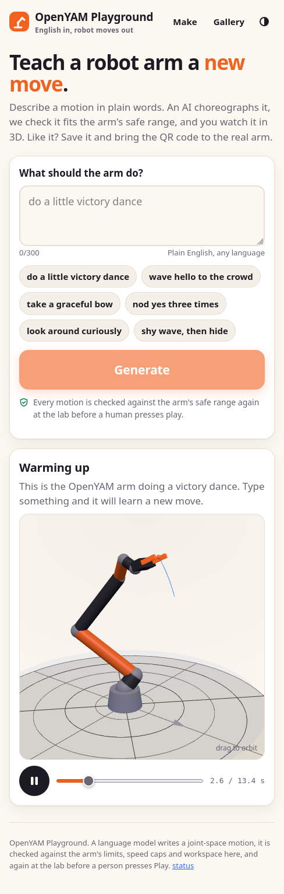
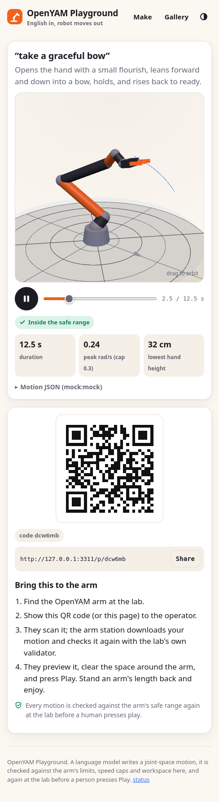
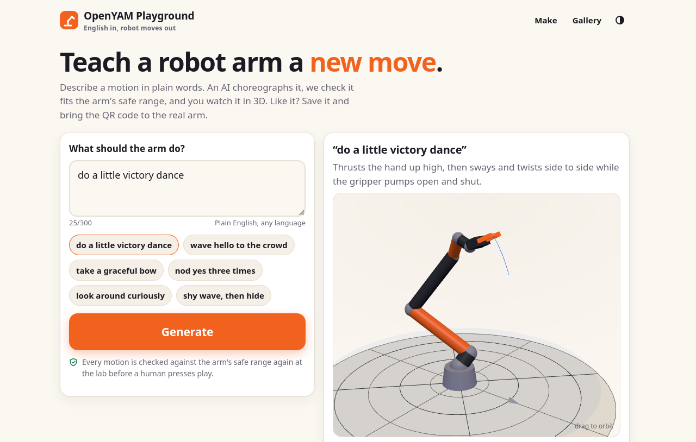

# OpenYAM Playground

People type English ("do a little victory dance"). A language model writes a robot-arm motion
sequence (a **playable**). The app checks it against the arm's safe range and shows it moving in 3D in
the browser. The person then gets a QR code or share link to bring to the physical OpenYAM arm at the lab.
There the operator scans it, the arm station checks it again with the lab's own validator, and a human
presses Play.

> Every motion is checked against the arm's safe range again at the lab before a human presses play.

| Phone: make | Phone: result | Phone: share page | Desktop |
|---|---|---|---|
|  |  |  |  |

More screenshots in `docs/screenshots/`: saved QR, offline link, gallery, and dark mode.

## How it works

```
prompt (<= 300 chars)
  -> LLM (Anthropic / Gemini on Vertex / OpenRouter / mock), structured JSON output
  -> validate: TypeScript port of the lab validator (armctl/playable.py + envelope.py)
     soft box = URDF limits - 0.1 rad; 0.3 rad/s; 1.0 rad/s^2; <= 60 s; t monotonic;
     start-pose transition; eases linear / cubic / hold; loops; grip speed
  -> geometry: forward kinematics from yam.urdf; the gripper tip must stay above the table
     plane (z >= 0.05 m) and must not go more than 0.10 m behind the base (x >= -0.10 m)
  -> problems go back to the model (up to 3 repair rounds, with tip xyz per keyframe)
  -> if only speed violations are left: retime (slow down just the offending segments)
  -> 3D preview -> "Save & get QR" -> /p/<id> (+ offline /p/local#<motion-in-URL>)
```

The model only writes motion JSON. It never streams motion, and the only fields kept are the motion
fields plus a short `notes` sentence (at most 200 characters, control characters removed). The prompt
is cleaned (control and bidi characters removed, at most 300 characters) and is only ever rendered as
escaped text.

### Improvement over the lab version: geometry feedback

The lab found that the LLM has joint names and limits but no geometry. Its "graceful bow" increased
j2 and j3, which on this arm *lifts* the tip up and back. The prompt here therefore includes:

- tip positions of labelled reference poses, computed with FK: home (0.211, 0, 0.174) m, ready
  (0.205, 0, 0.432) m, "lean forward and down (a real bow)" (0.383, 0, 0.319) m, and others;
- a "how each joint moves the tip from ready" table, computed by finite differences. For +0.3 rad:
  j2 moves the tip down 69 mm and forward 86 mm; j3 moves it up 115 mm and back 75 mm; j4 moves it
  up 56 mm and back 27 mm; j6 spins the hand in place;
- the workspace rules. Repair prompts include the tip xyz of every keyframe.

Playables whose tip goes below z = 0.05 m or further than 0.10 m behind the base are rejected and
sent back for repair.

## Stack

**Next.js 14 (app router, TypeScript)** on Node 18.19, which meets Next 14's minimum of 18.17, so
Hono+Vite wasn't needed. One codebase gives the API routes, the server-rendered share and gallery pages,
and the client 3D viewer. The validator and FK are plain TS modules shared by the server and the
browser, so the `/p/local#...` page validates offline links client-side. `output: "standalone"`
produces a small Docker image (156 MB), and the same repo deploys to Vercel unchanged.

- three.js 0.160 (procedural arm, see the license section), `qrcode` for PNG and client QRs, `fflate`
  for zlib.
- Postgres via `postgres` (porsager). The idempotent schema is applied on first use. Without
  `DATABASE_URL` the app uses an in-memory store.
- LLM: `@anthropic-ai/sdk` (structured output `output_config.format: json_schema`, server-side refusal
  fallbacks on by default). Gemini and OpenRouter use plain `fetch` to their REST APIs. See the Gemini
  section for why `@google/genai` isn't used.
- Tests: vitest (`npm test`).

## Local development

```bash
npm install
MOCK_LLM=1 npm run dev          # http://localhost:3000, sample playables, in-memory store
npm test                        # 108 tests (+1 Postgres test when TEST_DATABASE_URL is set)
npm run build && npm start      # production build
```

`MOCK_LLM=1` picks a sample playable by keyword (dance, wave, nod, bow, look...) after a short delay
(`MOCK_LLM_DELAY_MS`), so the whole UI works without keys.

### Environment variables (`.env.example`)

| Variable | Default | Meaning |
|---|---|---|
| `LLM_PROVIDER` | auto | `anthropic`, `gemini`, `openrouter` or `mock`. Auto: `MOCK_LLM=1` means mock, else the first provider with a key (anthropic, gemini, openrouter). With none configured, `/api/generate` returns 503 with a clear message. |
| `MOCK_LLM` | unset | `1` = canned sample playables |
| `ANTHROPIC_API_KEY`, `ANTHROPIC_MODEL` | `claude-sonnet-5-5` | Claude via the official SDK. `ANTHROPIC_FALLBACKS=0` disables server-side fallbacks. `ANTHROPIC_EFFORT` is optional. |
| `GEMINI_API_KEY`, `GOOGLE_CLOUD_PROJECT`, `GOOGLE_CLOUD_LOCATION`, `GEMINI_MODEL` | -, -, `global`, `gemini-2.5-flash` | Gemini on **Vertex AI** with an API key |
| `OPENROUTER_API_KEY`, `OPENROUTER_MODEL` | -, `anthropic/claude-sonnet-4.5` | OpenRouter (OpenAI-compatible) |
| `DATABASE_URL` | unset | Postgres connection string. Unset = in-memory (local dev only). |
| `PUBLIC_BASE_URL` | from Host header | Origin used in QR codes and links, e.g. `https://playground.positivesumexperiments.com` |
| `IP_HASH_SALT` | `openyam-playground` | Salt for hashing client IPs. Raw IPs are never stored. **Set a random value.** |
| `RATE_LIMIT_PER_HOUR` | `10` | Generations per IP per hour |

### LLM providers

- **anthropic**: `client.beta.messages.create` with `output_config.format = {type: "json_schema", schema}`
  (the same schema as the lab's `armctl/llm_author.py`). It also sends
  `fallbacks: "default"` + beta `server-side-fallback-2026-07-01`, so a policy refusal is retried
  server-side. A final `refusal` is reported as "the model declined".
- **gemini (Vertex AI)**: the deploy key is a Vertex key and is blocked on
  `generativelanguage.googleapis.com`. So the provider POSTs to
  `https://aiplatform.googleapis.com/v1/projects/$GOOGLE_CLOUD_PROJECT/locations/global/publishers/google/models/$GEMINI_MODEL:generateContent`
  with header `x-goog-api-key`, `responseMimeType: application/json` and a `responseSchema`. Without
  `GOOGLE_CLOUD_PROJECT` it uses the Vertex express-mode path
  (`/v1/publishers/google/models/...`). A non-`global` location uses `<location>-aiplatform.googleapis.com`.
  Plain `fetch` keeps that exact endpoint under our control, instead of relying on how
  `@google/genai` builds Vertex URLs in API-key mode.
- **openrouter**: `POST https://openrouter.ai/api/v1/chat/completions` with
  `response_format: {type: "json_schema", json_schema: {strict: true, ...}}`. If the routed model
  rejects that (400/422), it retries once with `{type: "json_object"}`. Pick the model with
  `OPENROUTER_MODEL`.

No API keys exist on the build machine, so every provider is covered by mocked unit tests (request
shape, repair loop, retime, errors). None has been called live yet. Smoke-test once after deploying:
`curl -X POST https://<host>/api/generate -H 'content-type: application/json' -d '{"prompt":"wave hello"}'`.

## Deploy

### Coolify (Dockerfile build pack)

1. **Postgres (optional, recommended).** In the Coolify project: *+ New -> Database -> PostgreSQL*.
   Start it and copy its **internal** connection URL
   (`postgres://user:pass@<service-name>:5432/postgres`). The table is created automatically on first
   use. To create it ahead of time instead, run `DATABASE_URL=... npm run migrate` (or `psql -f
   migrations/001_init.sql`).
2. **App.** *+ New -> Application* from this repo, build pack **Dockerfile**, port **3000**, domain
   e.g. `https://playground.positivesumexperiments.com`.
3. **Environment variables:**
   ```
   LLM_PROVIDER=openrouter            # or gemini
   OPENROUTER_API_KEY=...             # already available in Coolify
   OPENROUTER_MODEL=anthropic/claude-sonnet-4.5
   # or: LLM_PROVIDER=gemini, GEMINI_API_KEY=..., GOOGLE_CLOUD_PROJECT=..., GEMINI_MODEL=gemini-2.5-flash
   DATABASE_URL=postgres://...        # from step 1; omit to run with the in-memory store
   PUBLIC_BASE_URL=https://playground.positivesumexperiments.com
   IP_HASH_SALT=<random string>
   ```
4. Deploy. The image has a `HEALTHCHECK` on `/api/health`, which reports the provider and store kind.

Without `DATABASE_URL`, saved playables live in memory and disappear on restart or redeploy. Offline
`/p/local#...` links keep working because the motion is in the URL.

Client IPs for rate limiting come from `X-Real-IP` (set by Traefik and Vercel), else from the **last**
`X-Forwarded-For` entry.

### Vercel

Import the repo (framework preset: Next.js; the Dockerfile is ignored). Set the same env vars.
**`DATABASE_URL` is required on Vercel**, because serverless instances don't share memory. Use Neon
(Vercel Marketplace or neon.tech) and append `?sslmode=require`. `/api/generate` sets
`maxDuration = 120` to allow for an LLM call plus up to 3 repair rounds; Vercel Hobby caps this at
60 s, which is usually enough. On Vercel the in-process rate limiter is per instance, but the
Postgres-based per-IP count (rows in the last hour) applies across instances.

## GitHub Pages (static "bring your own AI" site)

`site/` is a static site published at https://nhajela.github.io/openyam-playground/ (no server, no
API keys): people point their own AI assistant at `spec/v1.md`, then check the result in
`viewer.html` (version gate, the same validator port and FK tip check as the app, 3D replay, joint
ranges, JSON download/copy, `viewer.html#p=` share link and QR). All URLs are relative, so it works
under the `/openyam-playground/` subpath.

- Build: `npm run build:site` (esbuild) bundles `site-src/viewer.ts` -> `site/assets/app.js`
  (reusing `src/lib/arm/*`, `src/lib/codec.ts`, three.js and `qrcode` from node_modules),
  `site-src/landing.ts` -> `landing.js`, and `site-src/site.css` (imports `src/app/globals.css`)
  -> `site.css`. These outputs are gitignored; CI builds them. `site/examples/*.json` filenames are
  embedded as a fallback when `examples/index.json` is absent.
- Share links: `viewer.html#p=<payload>`, where the payload is exactly the app's `/p/local#` fragment
  (base64url of zlib-deflated `{"v":1,"prompt"?,"playable"}`). The viewer also accepts a pasted
  `/p/local#...` URL, and `404.html` redirects `/<repo>/p/local#...` to the viewer.
- Deploy: `.github/workflows/pages.yml` runs `npm ci && npm test && npm run build:site` and deploys
  `site/` with `actions/upload-pages-artifact` + `actions/deploy-pages` on pushes to `main`.
  One-time setup: repo Settings -> Pages -> Source: **GitHub Actions**.
- Local check: serve the parent of a symlink named `openyam-playground -> site`
  (`python3 -m http.server 8765`) and run
  `/home/naman/openyam-robot-arm/.venv/bin/python scripts/site_check.py http://127.0.0.1:8765/openyam-playground/`
  (headless Firefox; compares verdicts with the lab's Python validator; writes `docs/screenshots/site-*.png`).

## How the lab arm station consumes it

The QR on a saved playable encodes `https://<host>/p/<id>`. The station can accept either form below.

**1. Online:** `GET https://<host>/api/p/<id>` (CORS `*`, read-only, 404 for unknown or invalid):

```json
{
  "format": "openyam-playable/v1",
  "id": "k7f3qz", "url": "https://<host>/p/k7f3qz", "status": "published",
  "created_at": "...", "prompt": "do a little victory dance", "model": "openrouter:...",
  "playable": {"name": "victory-dance", "space": "joint", "start": "ready",
               "keyframes": [{"t": 0, "q": [0,0.5,0.8,0,0,0], "grip": 0, "ease": "cubic"}, ...],
               "loop": 1, "speed": 1, "notes": "...", "author": "llm:...", "prompt": "..."},
  "check": {"ok": true, "validation": {...}, "geometry": {"min_z": 0.432, ...}, "checked_at": "..."},
  "envelope": {"soft_limits": [...], "vel_cap": 0.3, "acc_cap": 1.0, ...}
}
```

**2. Offline:** `https://<host>/p/local#<fragment>`, where the fragment is
`base64url(zlib(JSON))` with JSON = `{"v":1,"prompt":"...","playable":{...}}`. Nothing reaches the
server; the page decodes and validates it in the browser.

Station-side sketch (Python, lab repo):

```python
import base64, json, zlib, urllib.parse, urllib.request
from armctl import playable as P

def fetch_playable(scanned: str) -> dict:
    u = urllib.parse.urlparse(scanned)
    if u.path.rstrip("/") == "/p/local":
        f = u.fragment
        return json.loads(zlib.decompress(base64.urlsafe_b64decode(f + "=" * (-len(f) % 4))))["playable"]
    pid = u.path.rstrip("/").split("/")[-1]
    with urllib.request.urlopen(f"{u.scheme}://{u.netloc}/api/p/{pid}", timeout=10) as r:
        return json.load(r)["playable"]

pl = fetch_playable(qr_text)
r = P.validate(pl)                      # the lab's authoritative check; never trust the website's
assert r["ok"], P.report(r)
# then: preview in the console, operator confirmation, play_real.py / session_play.sh
```

Both paths were exercised end to end against the production build: the QR PNG was decoded with
OpenCV, `/api/p/<id>` was fetched, and the offline fragment was decoded with Python zlib. The lab's
`armctl.playable.validate` returned OK for all of them.

## Validator port and FK verification

- `src/lib/arm/playable.ts` ports `armctl/playable.py` (parse, timeline, 100 Hz sampling, validate
  incl. the `envelope.check_path` cross-check, retime, violation summary). The constants come from
  `armctl/envelope.py`.
- `tests/fixtures/python-reference.json` comes from `scripts/make_reference.py`, run with the lab venv
  (`npm run reference`). It holds 31 validation cases: all of the lab's `playables/*.json` plus mutations
  (out of range, too fast, linear eases, hold jumps, non-monotonic t, loops, too long, speed 2, offset
  start, start from home, fast gripper, schema errors). It also has 5 retime cases, 2 sampling cases and
  35 pinocchio FK poses. The TS port matches the Python on ok/not ok, violation kinds and joints,
  timings, worst values, limits, durations, max velocity and acceleration, transition, retimed keyframe
  times and sampled positions.
- FK (`src/lib/arm/kinematics.ts`) uses the joint origins and axes from
  `yam_description/i2rt/yam.urdf`, frame `gripper_tip` (10 cm beyond the gripper mount). Compared
  with pinocchio:

  | pose | pinocchio tip (m) | TS tip (m) |
  |---|---|---|
  | home `[0,0,0,0,0,0]` | (0.2106, 0, 0.1735) | same, < 0.1 mm |
  | ready `[0,0.5,0.8,0,0,0]` | (0.2049, 0, 0.4317) | same, < 0.1 mm |
  | lab "bow" peak `[0,1,1.4,0.7,0,0]` | (0.1747, 0, 0.6731) | same, < 0.1 mm |
  | 32 more (joint steps and random poses) | | all within 0.1 mm (gripper and tip frames) |

## License check (meshes)

- The DimOS repo (`~/.local/share/dimos/repo/LICENSE`) is Apache-2.0, Copyright Dimensional Inc.
- `yam_description/package.xml` declares Apache-2.0. `SOURCE_COMMIT.txt` says this covers the
  OpenYAM_description gravity-compensation model (no standalone LICENSE upstream). The visualization
  model `i2rt/yam.urdf` and `i2rt/assets/*.stl` are "redistributed" from
  `github.com/i2rt-robotics/i2rt` (commit 5d47b35), but **no license is stated for them** and no
  LICENSE file sits next to them.
- The only explicit mesh license is `meshes/flexible_4310/NOTICE` ("Copyright (c) I2RT contributors,
  MIT License"). It covers the Flexible 4310 gripper assets, which `yam.urdf` does not use.

**Decision:** the local evidence doesn't clearly permit redistributing the YAM STL meshes, so they are
**not** copied into this public app. The 3D view draws a procedural arm: capsules between the URDF joint
origins, a box gripper and two fingers. It is posed with the same FK the server uses for the geometry
check, so what you see is exactly what was checked. Only kinematic numbers (joint origins and axes) are
used. If the i2rt repository's license is confirmed (the vendored gripper NOTICE suggests MIT), the
meshes could be added under `public/` and loaded with `urdf-loader`, as the lab dashboard does.

## Data model

```sql
playables(id text pk  -- 6-char slug like 'k7f3qz' (no 0/o/1/l/i)
         , created_at timestamptz, prompt text, playable jsonb
         , validation jsonb  -- {ok, validation, geometry, attempts, retimed, provider, latency_s}
         , model text, ip_hash text  -- salted sha256, raw IP never stored
         , status text)      -- 'draft' (generated, valid) | 'published' (saved) | 'invalid'
```

Each generation inserts one row, which also feeds the per-IP rate limit. "Save & get QR" flips a valid
draft to `published`; only published rows appear in `/gallery`. `GET /api/p/<id>` serves drafts and
published rows (only the creator knows a draft id) and returns 404 for invalid ones.

## API

| Route | |
|---|---|
| `POST /api/generate` `{"prompt": "..."}` | Author and validate. Returns `{ok, id, playable, validation, geometry, attempts, retimed, model, local}`. 400 for an empty prompt or > 300 chars, 429 rate limit, 503 no LLM configured, 502 LLM failure. |
| `POST /api/p/<id>/publish` | Save a valid draft. Returns `{url, qr, api}`. |
| `GET /api/p/<id>` | Read-only JSON for the arm station (CORS open), re-checked on every request |
| `GET /api/p/<id>/qr.png` | 512 px QR of `https://<host>/p/<id>` |
| `GET /api/health` | `{ok, llm, store}` |

Pages: `/` (make), `/p/<id>` (replay, QR, "Bring this to the arm"), `/p/local#...` (offline link),
`/gallery`.

## Verification done

- `npm test`: 108 passed, plus the Postgres store test (109 with `TEST_DATABASE_URL`, run against a
  throwaway local Postgres 16). Covers the validator cross-check, FK vs pinocchio, geometry, repair
  loop, retime, provider request shapes (mocked fetch), codec incl. Python decode, ids, rate limit and
  the memory store.
- `npm run build`: passes. `docker build` passes, and the container served `/api/health`,
  `/api/generate` and `/`.
- Production server (`MOCK_LLM=1`, in-memory, and separately against Postgres), tested with curl:
  generate, publish, `GET /api/p/<id>` (CORS headers, OPTIONS 204), `qr.png` (decoded with OpenCV to the
  right URL), 404s, 400 for an over-long prompt, 429 on the 11th request in an hour, and a
  `<script>` prompt rendered escaped.
- Headless Firefox at 390x844 (`scripts/browser_check.py`), 16/16 checks: the WebGL canvas draws the
  arm, playback advances, save shows the QR, the share page, offline link and gallery work, dark mode
  applies, and there is no horizontal scroll. Screenshots are in `docs/screenshots/`.

## Layout

```
src/lib/arm/        envelope.ts, playable.ts (validator port + caps presets), format.ts (version gate),
                    kinematics.ts (FK + geometry), scene.ts (three.js arm, shared), check.ts, samples.ts
src/lib/llm/        prompt.ts, schema.ts, author.ts (repair loop), providers/{anthropic,gemini,openrouter,mock}.ts
src/lib/store/      postgres.ts, memory.ts, schema.ts (= migrations/001_init.sql)
src/app/            pages + api routes
src/components/     ArmViewer (three.js), Generator, ValidationSummary, ...
scripts/            make_reference.py (Python fixtures), browser_check.py, migrate.mjs,
                    build-site.mjs + site_check.py (GitHub Pages site)
site/               static GitHub Pages site (index, viewer, 404, spec/, examples/, llms.txt)
site-src/           viewer.ts, landing.ts, site.css -> bundled into site/assets/
```

## Known limits

- `notes` is a sentence the model wrote. It is length-limited, stripped of control characters and
  rendered escaped, but it is still model text.
- The lab's `play_real.py` v1 ignores the gripper channel, so gripper moves show in 3D only for now.
- Caps are the lab's conservative 0.3 rad/s and 1.0 rad/s². If the lab raises them in
  `armctl/envelope.py`, update `src/lib/arm/envelope.ts` and regenerate the fixtures.
